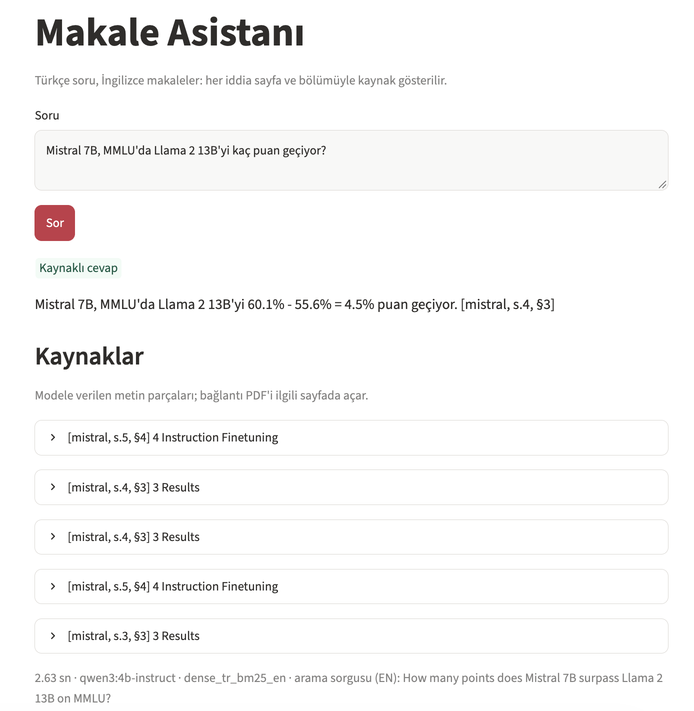
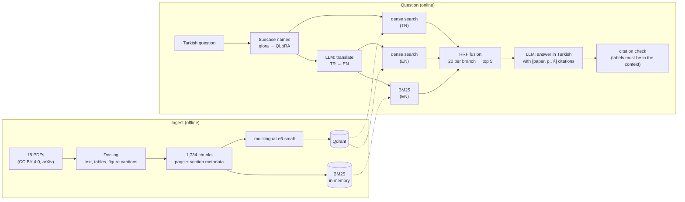

# Paper Assistant: Turkish Q&A over AI papers with cited sources

A retrieval-augmented generation (RAG) assistant that answers **Turkish** questions about 18
open-access AI papers (in English). Every claim cites the **paper, page and section** it came
from, and the citations are checked against the retrieved text. If the answer is not in the
papers, it says so: "Dokümanda bulamadım."

The focus is on retrieval and evaluation rather than model size: a small local model
(Qwen3 4B Instruct, via Ollama on a laptop) with hybrid search, query translation and a
measured evaluation set. Every number below comes from a recorded run in
[`docs/benchmarks/`](docs/benchmarks/); the reasoning behind each choice is in
[`docs/DECISIONS.md`](docs/DECISIONS.md) (in Turkish).



## How it works



- **Hybrid search, three branches:** dense search with the Turkish question and with its
  English translation, BM25 with the translation; ranks fused with Reciprocal Rank Fusion
  (no score normalization needed). BM25 needs the translation (Turkish words do not match
  English text); the Turkish dense branch keeps working when the translation is wrong.
- **Chunking** keeps tables whole or split by rows with their header, figure captions as
  their own chunks, and every chunk under "paper title > section".
- **Two-layer evaluation:** a fast retrieval eval without an LLM (in CI, with a quality
  gate) and a full eval of the answers with RAGAS and a local judge model.
- **Serving:** FastAPI (`/ask`, `/health`), a Streamlit page, Docker Compose, optional
  tracing in a self-hosted Langfuse.

## Results

Eval set: 49 Turkish questions (15 single-page, 10 table, 8 figure, 8 two-paper comparison,
8 not answerable from the papers), each labeled by how it is worded: with the paper's own
terms (`term`), in other words (`paraphrase`), or needing a calculation or combination
(`inference`). 20 were checked by hand; 29 were drafted by an LLM and verified
automatically by verbatim evidence quotes from the cited pages
([D35](docs/DECISIONS.md)). Setup: 18 papers, 1,734 chunks, MacBook Air M4 (16 GB).

**Retrieval** (41 answerable questions; evidence recall on the 25 with evidence quotes;
multilingual-e5-small, 20 results per branch):

| Retriever | Recall@5 (page) | Recall@10 | MRR | Evidence recall@5 (chunk) | R@5 `term` | R@5 `paraphrase` | R@5 `inference` |
|---|---|---|---|---|---|---|---|
| Dense, Turkish query | 0.561 | 0.780 | 0.512 | 0.407 | 0.500 | 0.571 | 0.636 |
| BM25, English query | 0.695 | 0.829 | **0.580** | 0.353 | **0.844** | 0.643 | 0.545 |
| Dense TR + BM25 EN | 0.768 | 0.866 | 0.509 | 0.587 | 0.719 | 0.893 | 0.682 |
| **Dense TR + dense EN + BM25 EN (default)** | **0.780** | **0.866** | 0.539 | **0.707** | 0.719 | **0.893** | **0.727** |

Page-level recall counts a hit when any chunk from the right page is retrieved; evidence
recall asks whether the sentence or table row the answer needs actually reaches the model.

**Answers** (Qwen3 4B Instruct, 5 chunks of context; judge: Gemma 3 12B, local):

| | Dense TR + BM25 EN | **Default** |
|---|---|---|
| Refuses when the answer is not in the papers | 8/8 | 8/8 |
| Correct (RAGAS answer accuracy ≥ 0.5 vs. the expected answer) | 26/41 | **29/41** |
| Answer accuracy, mean | 0.433 | **0.470** |
| Faithfulness (claims supported by the context) | 0.910 | — (not measured) |
| Answer relevancy | 0.877 | — (not measured) |
| Latency per question, median (translation + search + answer) | 10.1 s | 9.9 s |

The judge agreed with hand labels on 37 of 41 answers ([D40](docs/DECISIONS.md)).

**Small vs. larger model** (same retrieval and the same 5 chunks for both, translation fixed to
Qwen3 4B; judge Gemma 3 12B; [D48](docs/DECISIONS.md)):

| | Qwen3 4B Instruct | Qwen2.5 14B Instruct |
|---|---|---|
| Correct, all (answer accuracy ≥ 0.5, one judge error corrected by hand) | 29/41 | **33/41** |
| Tables | 3/10 | **8/10** |
| Questions needing a calculation or combination (`inference`) | 6/11 | **11/11** |
| Single-page questions | **15/15** | 13/15 |
| Refuses when the answer is not in the papers | 8/8 | 8/8 |
| Answer decoding speed (Ollama, M4) | 22.8 tokens/s | 7.1 tokens/s |
| Memory (Ollama) | 3.2 GB | 9 GB |

With good retrieval the 4B model is enough for single-page and paraphrased questions; the
14B model is much better at reading tables and combining numbers, but on a 16 GB laptop it
does not fit next to Docker and is ~3× slower. Both run free, locally; a commercial API was
not measured.

**Findings**
- **Query translation is what makes BM25 work** on Turkish questions over English papers
  (MRR 0.485 → 0.646 in an early 20-question run, [D32](docs/DECISIONS.md)).
- **Page-level recall is optimistic.** Tables are split into row groups; the right page can
  arrive without the needed row ([D36](docs/DECISIONS.md), [D37](docs/DECISIONS.md)).
- **Better retrieval did not always mean better answers.** A cross-encoder reranker raised
  MRR but not the number of correct answers, so it is off by default ([D33](docs/DECISIONS.md)).
- **Faithfulness is not correctness:** an answer that reads the wrong table row is fully
  faithful and still wrong; a reference-based score catches it ([D39](docs/DECISIONS.md), [D40](docs/DECISIONS.md)).
- **Decisions were re-measured as the eval set grew:** a retriever rejected on 20 questions
  and 5 papers became the default on 49 questions and 18 papers ([D46](docs/DECISIONS.md)).
- **Robust to how names are typed:** with all questions in lowercase ("qlora", "ares"), evidence
  recall@5 fell from 0.707 to 0.493, mostly because the translator no longer recognized the
  names. Restoring their usual spelling from a corpus-derived vocabulary (truecasing) brings it
  back to 0.707 ([D47](docs/DECISIONS.md); `uv run python -m eval.robustness`).
- **Main remaining weakness:** reading tables with a 4B model, even when the right rows are
  in the context; a 14B model fixes most of it (tables 3/10 → 8/10) but does not fit this
  laptop well ([D38](docs/DECISIONS.md), [D48](docs/DECISIONS.md)).
- **Measure on a quiet machine:** Docker Desktop keeps its 8 GB reserved even with no
  container running; with it open, model timings were swap-bound. Speed runs now record
  swap activity ([D48](docs/DECISIONS.md)).

## Tech stack

| Area | Tools |
|---|---|
| Language / API | Python 3.12, FastAPI, Pydantic |
| LLM orchestration | LangChain, LangGraph (agentic flow, planned) |
| LLM serving | Any OpenAI-compatible API: Ollama (local), vLLM (GPU), commercial APIs (optional) |
| Retrieval | Qdrant, BM25, Hugging Face `sentence-transformers` (embeddings, reranker) |
| Evaluation | RAGAS + custom Recall@k / MRR |
| Observability | Langfuse |
| UI / Infra | Streamlit, Docker Compose, GitHub Actions |

## Quickstart

Prerequisites: [uv](https://docs.astral.sh/uv/), [Ollama](https://ollama.com/) and Docker (for Qdrant).

```bash
# 1. Install dependencies into a local virtual environment (.venv)
uv sync

# 2. Create your local settings file (never committed)
cp .env.example .env

# 3. Start the model server (in a separate terminal) and download a model
ollama serve
ollama pull qwen3:4b-instruct

# 4. Check the LLM connection
uv run python -m app.llm "Merhaba, kendini tanıtır mısın?"

# 5. Download the papers listed in data/SOURCES.md (licenses are re-checked)
uv run python -m ingest.download

# 6. Parse PDFs with Docling into data/parsed/ (first run downloads layout models)
uv run python -m ingest.parse

# 7. Split parsed elements into retrieval chunks (data/chunks.jsonl)
uv run python -m ingest.chunk

# 8. Start the Qdrant vector database (dashboard: http://localhost:6333/dashboard)
docker compose -f infra/docker-compose.yml up -d qdrant

# 9. Embed the chunks and write them to Qdrant (first run downloads the embedding model)
uv run python -m ingest.index

# 10. Fast eval: retrieval metrics (Recall@k, MRR) on the eval set, no LLM call
uv run python -m eval.run --fast

# 11. Ask a question: answer in Turkish with [paper, page, section] citations
uv run python -m app.ask "Ragas bir RAG sistemini hangi boyutlarda değerlendirir?"
```

Fast-eval results are saved to `docs/benchmarks/fast_eval/` with the model, hardware and git commit.

The model server is configured only through environment variables (`LLM_BASE_URL`, `LLM_MODEL`, `LLM_API_KEY`). To switch to vLLM or another provider, edit `.env`; no code changes are needed.

## HTTP API

```bash
uv run uvicorn app.api:app --port 8000   # Qdrant and the LLM server must be running
```

- `POST /ask` with `{"question": "..."}` returns the answer, its kind (answer / partial /
  refusal), the English query, the cited sources (label, paper, pages, section, text) and
  any cited label that was not in the context.
- `GET /health` checks the vector index (`{"status": "ok", "chunks": 1734}`).
- Interactive documentation: http://localhost:8000/docs

```bash
curl -s -X POST localhost:8000/ask -H 'Content-Type: application/json' \
  -d '{"question": "QLoRA hangi üç yenilikle bellek tasarrufu sağlıyor?"}'
```

## Web UI (Streamlit)

```bash
uv run uvicorn app.api:app --port 8000          # 1. the API (see above)
uv run --group ui streamlit run ui/app.py       # 2. the page: http://localhost:8501
```

Ask in Turkish; the answer comes with a badge (cited answer / partial / not found), a
warning for any cited label that was not in the context, and the sources: each one opens
the chunk given to the model and links to the paper's PDF at the cited page. The page is a
thin client of the API (`API_URL`, default `http://localhost:8000`) and loads no model.

## Run with Docker

Qdrant, the API and the web UI in containers; the LLM runs natively (Ollama on a Mac uses
the GPU; Docker Desktop on macOS cannot give containers a GPU):

```bash
ollama serve                                               # the LLM, on the host
docker compose -f infra/docker-compose.yml up -d --build   # Qdrant + API + UI
# UI http://localhost:8501 · API http://localhost:8000/docs
```

The index must exist (`uv run python -m ingest.index`, see Quickstart); `data/` is mounted
read-only into the API container, and the embedding model is downloaded once into a volume.

| Profile | What it adds | When |
|---|---|---|
| _(none)_ | Qdrant, API, UI | default; LLM on the host (`host.docker.internal`) |
| `dev` | Ollama in a container | Linux / Windows: `DOCKER_LLM_BASE_URL=http://ollama:11434/v1 ... --profile dev up -d` |
| `gpu` | vLLM on an NVIDIA GPU | Linux / WSL 2: `DOCKER_LLM_BASE_URL=http://vllm:8000/v1 LLM_MODEL=<model> ... --profile gpu up -d` |
| `obs` | Langfuse | `infra/docker-compose.obs.yml` (see Tracing) |

Stop: `docker compose -f infra/docker-compose.yml down`. If Langfuse is running too, this
prints "Network infra_default Resource is still in use" (both files share the `infra`
network, so the API can send traces); to stop everything, pass both files:
`docker compose -f infra/docker-compose.yml -f infra/docker-compose.obs.yml --profile obs down`.

Images: API ~2.2 GB (CPU-only PyTorch), UI ~0.9 GB (no PyTorch); arm64 is built on a Mac,
amd64 in CI. Set a disk limit in Docker Desktop (Settings → Resources) and clean the build
cache now and then (`docker builder prune`).

## Tracing (optional, Langfuse)

Every question can be traced step by step (translation, each retriever branch, fusion,
prompt, LLM calls, with timings and token counts) in a self-hosted Langfuse:

```bash
uv run python infra/make_secrets.py   # once: local secrets + LANGFUSE_* keys in .env
docker compose -f infra/docker-compose.yml -f infra/docker-compose.obs.yml --profile obs up -d
# UI: http://localhost:3000 (login in infra/.env)
```

Without `LANGFUSE_*` keys in `.env`, nothing is sent and the code runs unchanged.
The stack (web, worker, Postgres, ClickHouse, Redis, MinIO) uses about 3 GB of memory.

## Development

```bash
uv run pytest                                      # tests
uv run ruff check . && uv run ruff format --check .  # lint + format check
```

## Project layout

```
app/        # retrieval (dense, BM25, fusion, reranker), translation, answer chain, API, tracing
ingest/     # data pipeline: download, parse (Docling), chunk, index (Qdrant)
eval/       # eval set, metrics, fast / answer / full (RAGAS) evals, evidence checks
ui/         # Streamlit page (a client of the API)
infra/      # Dockerfile, docker-compose (Qdrant, API, UI; dev/gpu profiles; Langfuse)
data/       # SOURCES.md with attribution; PDFs, chunks and indexes stay local
docs/       # DECISIONS.md (design decisions, in Turkish), benchmarks/, images/
tests/      # pytest suite (runs in CI with fakes: no LLM, no Qdrant)
.github/    # CI: lint + tests, fast eval with a quality gate, Docker builds (amd64)
```

## Data and licensing

Only papers under CC BY 4.0 are used; authors, links and the modifications made are listed in [`data/SOURCES.md`](data/SOURCES.md). Raw PDFs and indexes are not stored in this repository; scripts to download and process them are. CI gets the chunk file from a GitHub Release asset ([D42](docs/DECISIONS.md)).
